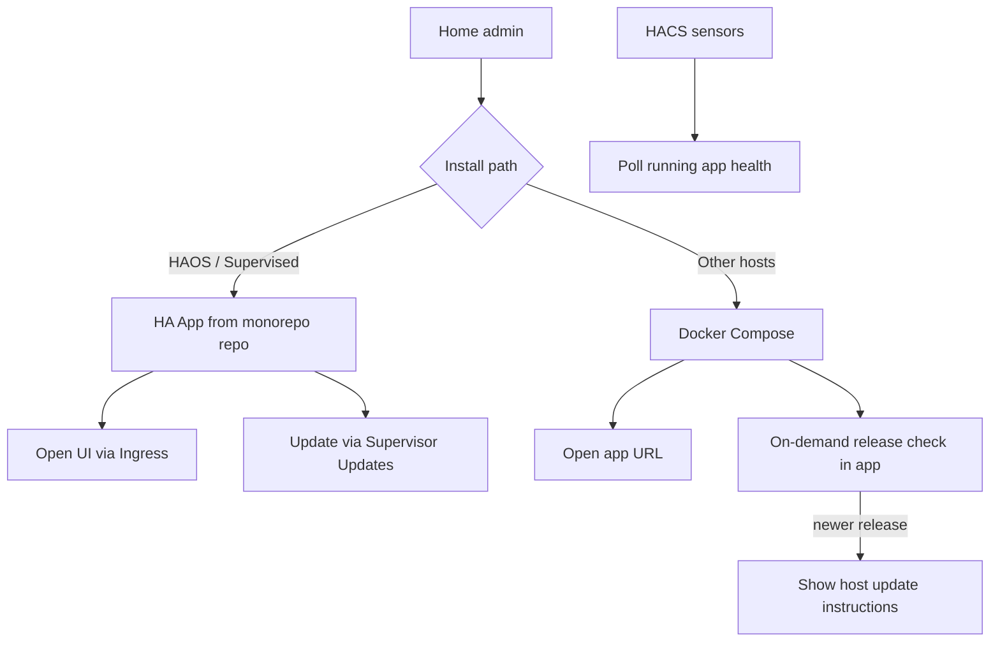
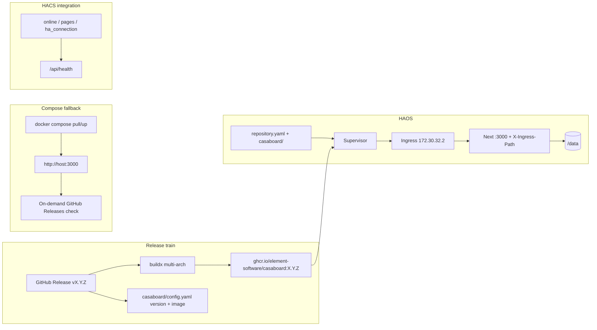

# HA App Install and Updates - Plan

## Goal Capsule

- **Objective:** Make Home Assistant OS/Supervised the primary way to install and update CasaBoard as an HA **App** (formerly add-on) with Ingress and Supervisor Updates, with Compose remaining a documented fallback that can detect newer GitHub Releases and show host-side update instructions.
- **Product authority:** This Product Contract. README / HACS docs must be brought in line when implementing; until then this plan is the source of intended product behavior.
- **Open blockers:** None — v1 publish mode is settled (pre-built multi-arch registry images). Panel removal and ingress strategy are settled.
- **Execution profile:** Packaging + CI + Next ingress path adaptation + HACS panel removal + Compose release check. Prefer smoke/runtime proof for App/Ingress units; unit-test pure helpers (semver compare, ingress path prefixing).
- **Stop conditions:** Stop if Supervisor rejects the App metadata, if Ingress cannot serve navigable UI without nginx rewrite (escalate with evidence), or if GHCR multi-arch publish cannot be authenticated for `element-software`.

---

## Product Contract

### Summary

Ship CasaBoard as a Home Assistant App defined in this monorepo so HAOS users install and update through Supervisor.
Compose stays supported with check-only “update available” against GitHub Releases.
The HACS integration keeps health sensors; the sidebar panel moves to App Ingress.
HACS `panel_custom` registration is removed in the same release (not soft-deprecated).
Ingress uses in-app `X-Ingress-Path` awareness (not an nginx HTML-rewrite edge).

### Problem Frame

Self-hosted CasaBoard today is `git clone` + `docker compose up -d`, with no first-class update path.
Home Assistant users expect Apps/Updates in HA for companion software; asking them to SSH and rebuild is a poor fit for that audience.
A privileged in-app rebuild (Docker socket / sidecar) can work for Compose, but fights CasaBoard’s simple trusted-LAN model and is the wrong primary story for HAOS.

### Key Decisions

- **HA App is the primary install/update path** — Supervisor owns lifecycle and Updates UI for HAOS/Supervised users. `(session-settled: user-directed — chosen over in-app Compose one-click, HA Update entity as primary, or CasaBoard-only Update: want native HA app packaging)`
- **Compose remains a fallback** — non-HAOS installs keep Docker Compose; they do not get the same Update UX as Supervisor. `(session-settled: user-directed — chosen over add-on-only or shared-image-first packaging)`
- **Compose updates are check-only** — show when a newer GitHub Release exists and give host instructions; no one-click pull/rebuild. `(session-settled: user-directed — chosen over manual-docs-only or sidecar one-click)`
- **Ingress replaces the HACS sidebar panel** — the App serves the UI inside HA; HACS shrinks to sensors (and optional non-panel extras). `(session-settled: user-directed — chosen over keeping iframe panel for all installs)`
- **HACS panel registration is removed in the same release** — no temporary iframe fallback in the integration. `(session-settled: user-directed — chosen over soft-deprecate/keep panel)`
- **“Newer” means a published GitHub Release / semver**, not commits on `main`. `(session-settled: user-directed — chosen over tracking default-branch commits or dual release+dev channels in v1)`
- **App packaging lives in this monorepo** — Supervisor custom-repository install from the CasaBoard GitHub repo (`repository.yaml` + app folder). `(session-settled: user-approved — chosen over a separate app repo or community-store-first: one release train)`
- **Compose release checks are on-demand** — when the user opens the update section in the app (default accepted at synthesis confirm).
- **Terminology:** Product and docs should prefer Home Assistant’s current name **App** (formerly add-on), while remaining clear for users who still search “add-on.”
- **v1 ships pre-built multi-arch registry images** — Supervisor pulls from a container registry (GHCR); no Supervisor local builds as the v1 path. `(session-settled: user-directed — chosen over local-build-first)`
- **Ingress path strategy is in-app `X-Ingress-Path`** — runtime prefixing of links, assets, and redirects; not an nginx sub_filter edge. `(session-settled: user-directed — chosen over nginx rewrite proxy)`

### Actors

- A1. HAOS / Supervised home admin — installs CasaBoard from the App store (custom repo), opens it via Ingress, updates from HA Updates.
- A2. Compose host admin — runs `docker compose`, opens the app by URL, may use HACS sensors against that URL.
- A3. Supervisor — runs the App container, surfaces version/update/install.
- A4. HACS CasaBoard integration — polls app health/sensors; does not own the primary sidebar UI after Ingress lands.

### Key Flows



- F1. HAOS install and open
  - **Trigger:** Admin adds the CasaBoard GitHub repo as a Supervisor App repository and installs CasaBoard.
  - **Actors:** A1, A3
  - **Steps:** Install App; start it; open via Ingress; configure HA connection inside CasaBoard as today.
  - **Outcome:** Dashboards are edited/viewed inside HA without a separate HACS panel registration.
  - **Covered by:** R1, R2, R3, R14

- F2. HAOS update
  - **Trigger:** A newer App version is available in the repository.
  - **Actors:** A1, A3
  - **Steps:** HA Updates shows CasaBoard; admin confirms/installs; Supervisor replaces the App container; dashboard data persists across the update.
  - **Outcome:** Running CasaBoard matches the new App version without host git/compose commands.
  - **Covered by:** R4, R5

- F3. Compose update awareness
  - **Trigger:** Compose admin opens the update section.
  - **Actors:** A2
  - **Steps:** App compares its installed release identity to the latest GitHub Release; if behind, show that an update is available plus copy-pasteable host instructions; if current, show up to date.
  - **Outcome:** Admin knows whether to update and how, without the app rebuilding itself.
  - **Covered by:** R9, R10, R11, R12

### Requirements

**HA App packaging and HAOS UX**

- R1. CasaBoard is installable as a Home Assistant App from this monorepo via Supervisor’s custom repository flow (`repository.yaml` at repo root + App folder with `config.yaml`).
- R2. On HAOS/Supervised, the primary UI entry is App Ingress (sidebar / Open Web UI), not the HACS `panel_custom` iframe.
- R3. App install preserves the local-only product stance: no CasaBoard account/cloud login; HA credentials stay on the user’s machine as today.
- R4. App updates are performed through Home Assistant’s native Updates / Apps update flow (Supervisor), not an in-app rebuild control.
- R5. Dashboard and connection data survive App updates (equivalent durability to today’s Compose `./data` bind mount; use Supervisor persistent `/data` as appropriate).
- R14. Ingress follows HA App requirements: enabled in App config; web UI reachable on the configured ingress port; only Supervisor ingress traffic is accepted (HA documents allowing `172.30.32.2` and denying other peers for ingress); Home Assistant handles user authentication at the ingress edge; the Next app honors `X-Ingress-Path` at runtime so navigation and static assets work under the dynamic ingress prefix.
- R15. The App repository presentation includes the artifacts HA expects for a public App: intro/docs suitable for the store, `icon.png` / `logo.png`, and a changelog users see on upgrade.
- R16. The monorepo must not introduce additional recursive `config.yaml` files outside the App folder — Supervisor searches the repository for App configs.
- R17. The App `config.yaml` references a published multi-arch image (e.g. GHCR) rather than requiring Supervisor to build from the monorepo Dockerfile.
- R18. CI publishes multi-arch App images on the release train (aligned with GitHub Releases / App `version`) so HA Updates can pull a new tag.

**HACS integration**

- R6. The HACS integration continues to expose health-oriented sensors against a running CasaBoard base URL for installs that still need them.
- R7. The HACS integration removes sidebar `panel_custom` registration in the same release Ingress becomes the HAOS UI path; docs describe Ingress for HAOS and direct URL for Compose.

**Compose fallback**

- R8. Compose install remains documented and supported as a fallback for non-HAOS hosts.
- R9. In the Compose-running app, an update section performs an on-demand check against GitHub Releases and reports whether a newer release exists.
- R10. When a newer release exists, the app shows host-side update instructions; it does not pull, rebuild, or recreate containers itself.
- R11. When already on the latest release, the update section reports that clearly.

**Versioning signal**

- R12. “Update available” for Compose is based on published GitHub Release / semver identity, not on commits ahead on `main`.
- R13. App versioning is aligned with the same release train so HAOS and Compose users talk about the same release numbers.

### Acceptance Examples

- AE1. HAOS happy path
  - **Covers:** R1, R2, R4, R14
  - **Given:** Supervisor has the CasaBoard custom App repository.
  - **When:** Admin installs CasaBoard and opens it from the sidebar / Open Web UI.
  - **Then:** The app loads via Ingress (HA-authenticated), and later updates appear under HA Updates rather than requiring SSH.

- AE2. Data survives App update
  - **Covers:** R5
  - **Given:** Pages and HA connection exist in the running App.
  - **When:** Admin installs a newer App version from HA Updates.
  - **Then:** After restart, those pages and the HA connection are still present.

- AE3. Compose behind a release
  - **Covers:** R9, R10, R12
  - **Given:** The running Compose app identifies as an older release than the latest GitHub Release.
  - **When:** Admin opens the update section.
  - **Then:** The UI shows an update is available and gives host instructions; no container rebuild is triggered by the app.

- AE4. Compose current
  - **Covers:** R11
  - **Given:** The running app matches the latest GitHub Release.
  - **When:** Admin opens the update section.
  - **Then:** The UI reports up to date.

- AE5. HACS sensors without panel ownership
  - **Covers:** R6, R7
  - **Given:** A Compose or App instance is reachable at a configured URL.
  - **When:** The HACS integration is configured with that URL.
  - **Then:** Online/pages/connection sensors still work; no CasaBoard iframe panel is registered; HAOS users use Ingress for the UI.

### Success Criteria

- A HAOS user can install, open, and update CasaBoard without using git or Compose on the host.
- A Compose user can learn that a newer release exists and what to run, without granting the app Docker privileges.
- README / install docs describe the HA App as primary and Compose as fallback, matching the Product Contract.
- App security posture prefers Ingress and avoids privileged Docker-host APIs (`docker_api` / full host access) that collapse the Supervisor security rating.

### Scope Boundaries

**Deferred for later**

- Compose one-click pull/rebuild (updater sidecar, docker.sock, host agent)
- Home Assistant Community Apps store / default-store submission as a v1 requirement (custom repository install needs no submission)
- HA `update` entity in the custom integration as a parallel install surface (Supervisor Apps updates cover the App)
- Tracking `main` commits or a separate “dev channel” in the Compose update UI
- Replacing non-Docker (bare Node) installs with a first-class update story
- nginx/Caddy ingress rewrite edge (only if in-app `X-Ingress-Path` proves infeasible)

**Outside this product's identity**

- Cloud-hosted CasaBoard or mandatory accounts for updates
- Requiring Home Assistant for Compose users (Compose remains standalone-capable)

### Dependencies / Assumptions

- Users on the primary path run Home Assistant OS or Supervised with App support.
- The CasaBoard GitHub repository is (or will be) public so Supervisor can use it as a custom App repository.
- GitHub Releases will be used as the shared version signal for Compose checks and App version bumps.
- Existing `/api/health` remains useful for HACS sensors; it does not need to become the update mechanism.
- HA’s recommended publish path is pre-built multi-arch registry images; that is the v1 path.
- Custom App repos do not require official store submission.
- Supervisor mounts persistent `/data` for Apps; CasaBoard already uses `DATA_DIR=/data`.

### Outstanding Questions

None blocking. Deferred implementation notes live under Planning Contract → Open Questions.

### Sources / Research

- Current install path: `README.md` (`git clone` + `docker compose up -d`); `Dockerfile` + `docker-compose.yml` (`build: .`, `./data:/data`).
- HACS integration today: `custom_components/casaboard` — config flow, sidebar `panel_custom`, health sensors via `/api/health`; no Update entity; `manifest.json` version `0.1.0`.
- Next app: `apps/app/next.config.js` has `output: "standalone"` only — no `basePath` / `assetPrefix`; widespread root-absolute `href="/..."` and `router.push("/...")` in `packages/ui`.
- No existing App packaging or GHCR App image workflow (as of planning); `.github/workflows/publish-ha.yml` publishes npm `@casaboard/ha` only.
- [Publishing](https://developers.home-assistant.io/docs/apps/publishing/) — prefer pre-built multi-arch images; generic multi-arch image name in `config.yaml`.
- [Presentation / Ingress](https://developers.home-assistant.io/docs/apps/presentation/) — `ingress: true`, default port 8099 or `ingress_port`, allow `172.30.32.2`, `X-Ingress-Path`.
- [Repositories](https://developers.home-assistant.io/docs/apps/repository/) — root `repository.yaml`; users paste git URL (no store submission required).
- [Configuration](https://developers.home-assistant.io/docs/apps/configuration/) — per-app folder `config.yaml`; Supervisor recursively searches for App configs.
- Example: [home-assistant/apps-example](https://github.com/home-assistant/apps-example); builder: [home-assistant/builder](https://github.com/home-assistant/builder).

---

## Planning Contract

### Key Technical Decisions

- KTD1. **App folder `casaboard/` at repo root** — holds `config.yaml`, `DOCS.md`, `CHANGELOG.md`, `icon.png`, `logo.png`; slug `casaboard`. Distinct from `custom_components/casaboard` (HACS). No other `config.yaml` anywhere in the monorepo (R16).
- KTD2. **Same GHCR image for App and Compose** — `ghcr.io/element-software/casaboard` built from the existing root `Dockerfile` via docker buildx multi-arch; App `config.yaml` sets `image:` to that name. Prefer this over HA builder’s addon-folder Dockerfile context, which cannot see the monorepo workspace layout cleanly. `(inherits session-settled: registry images)`
- KTD3. **Keep container `PORT=3000`; set `ingress_port: 3000`** — reuse the working Compose image; do not expose host `ports:` in App config so HAOS users enter via Ingress only.
- KTD4. **Persist on Supervisor `/data`** — keep `DATA_DIR=/data` (already in Dockerfile). No extra `map` required for primary dashboard/connection JSON; document that `/data` is the App persistent volume.
- KTD5. **Ingress path via runtime `X-Ingress-Path`** — do not set Next `basePath` (tokenized path is runtime-only). Middleware/helpers read the header; prefix Next links, redirects, and asset URLs; no-op when header absent (Compose/direct). `(session-settled: user-directed — chosen over nginx rewrite)`
- KTD6. **Ingress peer allowlist when Supervisor-managed** — when `SUPERVISOR_TOKEN` is present, reject non-`172.30.32.2` peers on the HTTP listener; Compose/direct remains open on the published port.
- KTD7. **Remove HACS panel registration immediately** — drop `panel.py` setup, `www/casaboard-panel.js`, `panel_custom` manifest deps, and sidebar title/icon options; keep sensors + `casaboard.refresh`. Update `validate-hacs.yml` layout checks. `(session-settled: user-directed — chosen over soft-deprecate)`
- KTD8. **Bake release identity at image build** — `CASABOARD_VERSION` (and a public equivalent for UI) from the GitHub Release / tag that triggered the build; Compose update check compares that to the latest GitHub Release semver for this repo.
- KTD9. **Compose docs default to pulling the GHCR tag** — `docker-compose.yml` prefers `image: ghcr.io/element-software/casaboard:<tag>` with optional local `build: .` for contributors; update instructions use pull + up, not rebuild-from-git as the primary path.
- KTD10. **Release train** — one semver for App `config.yaml` `version`, GHCR tag, and GitHub Release; bump them together. HACS integration `manifest.json` version may track separately but docs should not confuse App version with integration version.
- KTD11. **HACS sensor URL on HAOS is optional/advanced** — Ingress URL is browser-auth’d and not a stable poll target for the integration. Docs tell HAOS users that HACS sensors need a direct container URL if offered later; v1 default is sensors for Compose (and any install with a plain HTTP base URL). Do not invent `host_network` just to make HACS polling easy. Trust `X-Ingress-Path` for URL rewriting primarily when Supervisor-managed (paired with KTD6).

### Assumptions

- GitHub Packages (GHCR) permissions for `element-software` will allow public pull of the App image.
- Next App Router can be adapted to honor a dynamic ingress prefix without a custom Node server; if smoke testing under real Ingress fails, escalate before adding nginx (deferred fallback).
- HACS users who relied solely on the iframe panel will migrate to Ingress (HAOS) or the direct URL (Compose); no migration shim.

### High-Level Technical Design



Ingress request shape (directional):

```text
Browser:  /api/hassio_ingress/<token>/setup/pages
HA edge:  strips prefix, sets X-Ingress-Path: /api/hassio_ingress/<token>
App sees: /setup/pages  + header
App emits: links/assets prefixed with X-Ingress-Path
```

### Output Structure

```text
repository.yaml
casaboard/
  config.yaml
  DOCS.md
  CHANGELOG.md
  icon.png
  logo.png
  README.md          # short store blurb or pointer
.github/workflows/
  publish-app-image.yml   # new — GHCR multi-arch
Dockerfile                # existing — bake CASABOARD_VERSION
docker-compose.yml        # prefer image pull
apps/app/                 # ingress middleware/helpers + update UI/API
custom_components/casaboard/  # panel removed; sensors kept
```

### Sequencing

1. App metadata + GHCR publish (U1 → U2) so an image exists to install.
2. Ingress path + peer allowlist (U3, U4) before declaring HAOS UI ready.
3. Remove HACS panel (U5) in the same docs/release cut as Ingress.
4. Compose update check (U6) once version bake exists.
5. Docs (U7) last or in parallel with U5–U6, before announcing primary install path.

### Open Questions (deferred to implementation)

- Exact Next middleware vs layout injection mechanism for asset prefixing under App Router (prove with Ingress smoke).
- Whether optional App `ports` for advanced users who want LAN-direct access should be documented (default: omit).
- GHCR package visibility and first-time package creation permissions.

---

## Implementation Units

### U1. HA App repository metadata

**Goal:** Make the monorepo a valid Supervisor App repository with Ingress-ready `config.yaml` pointing at GHCR.

**Requirements:** R1, R2, R3, R5, R14, R15, R16, R17

**Dependencies:** None

**Files:**
- create: `repository.yaml`
- create: `casaboard/config.yaml`
- create: `casaboard/DOCS.md`
- create: `casaboard/CHANGELOG.md`
- create: `casaboard/README.md`
- create: `casaboard/icon.png`, `casaboard/logo.png` (reuse/adapt from `custom_components/casaboard/brand/` or `brand/` as available)

**Approach:**
- Root `repository.yaml` with name/url/maintainer for CasaBoard.
- `casaboard/config.yaml`: `slug: casaboard`, `ingress: true`, `ingress_port: 3000`, `image: ghcr.io/element-software/casaboard`, `arch: [aarch64, amd64]`, `version` aligned with first release, `init: false`, no `docker_api` / `full_access` / `host_network`, no host `ports` by default.
- Store docs describe custom-repo install (no official store submission).
- Ensure no other `config.yaml` exists in the repo.

**Execution note:** This is mostly packaging/config; prefer Supervisor install smoke over unit coverage.

**Test scenarios:**
- Test expectation: none for automated unit tests — validate by Supervisor “add repository” recognition and config schema fields present.
- Manual: repo root contains exactly one App `config.yaml` under `casaboard/`.

**Verification:** Supervisor can list CasaBoard from the custom repository URL once the branch/tag is public; config references the GHCR image name.

---

### U2. Multi-arch GHCR publish and version bake

**Goal:** Publish `ghcr.io/element-software/casaboard` multi-arch images on the release train and bake `CASABOARD_VERSION` into the image.

**Requirements:** R13, R17, R18, R12

**Dependencies:** U1 (image name / version field agreement)

**Files:**
- create: `.github/workflows/publish-app-image.yml`
- modify: `Dockerfile` (ARG/ENV for version)
- modify: `docker-compose.yml` (prefer `image:` + optional build)
- modify: `apps/app/package.json` or build args as needed for public version surface

**Approach:**
- Trigger on GitHub Release / `v*` tags (distinct from existing `ha-v*` npm publish for `@casaboard/ha`).
- docker buildx for `linux/amd64` and `linux/aarch64` (HA arch names map to these platforms).
- Tag `:version` and optionally `:latest`.
- Pass build-arg into runtime `CASABOARD_VERSION`.
- Do not reuse `.github/workflows/publish-ha.yml` (npm only) — keep concerns separate; rename docs if the workflow name confuses contributors.

**Execution note:** Prefer CI dry-run / workflow validation and a pulled image smoke (`node` health) over unit tests.

**Test scenarios:**
- Test expectation: none automated in-repo beyond workflow YAML review — CI must push manifests for both arches on a test tag in a staging dry-run when possible.
- Happy path: tagged release produces pullable `ghcr.io/element-software/casaboard:<version>` for amd64 and arm64.
- Edge: workflow does not publish on non-release pushes.

**Verification:** `docker pull` works for the published tag; container env exposes the expected version; App `config.yaml` `version` matches the tag used for that release.

---

### U3. Runtime Ingress path support in the Next app

**Goal:** Under HA Ingress, navigation, redirects, and static assets stay under the dynamic `X-Ingress-Path` prefix; Compose/direct URLs keep working with no prefix.

**Requirements:** R2, R14, AE1

**Dependencies:** None (can develop against a header-injecting local proxy before App packaging lands)

**Files:**
- create: `apps/app` middleware and/or ingress helper module (exact paths chosen in impl)
- create: tests for pure prefix helpers (e.g. under `apps/app` or `packages/lib`)
- modify: `apps/app/next.config.js` only if a non-`basePath` technique requires it (do not bake static `basePath`)
- modify: root-absolute navigations in `packages/ui` and app routes to go through the ingress-aware helper / Link wrapper
- modify: `packages/lib/ha/requireValidHAConnection.ts` redirects if they use root-absolute paths

**Approach:**
- Read `X-Ingress-Path` on each request; empty/missing ⇒ prefix `""`.
- Provide a small API: normalize prefix, join app paths, and a Link/redirect helper used by UI.
- Prefer one choke-point over scattering string prefixes; audit `href="/`, `router.push("/`, and `redirect("/`.
- Server and client must agree; document that Next static `basePath` is intentionally unused because Ingress tokens change.
- Directional order of attack: (1) pure path helpers + tests, (2) server redirects/`next/link` wrapper using request header or a short-lived cookie mirroring the prefix, (3) ensure `/_next/static` and RSC fetches inherit the browser’s current ingress location (relative asset URLs or header-driven prefix — prove which Next 16 standalone emits), (4) critical-path UI audit.
- WebSocket/HLS camera flows that build absolute URLs must be checked for prefix leakage (only if they hit same-origin app routes).

**Execution note:** Prove with a local reverse-proxy that strips a fake ingress prefix and sets `X-Ingress-Path` before calling HAOS smoke done. If `/_next` assets 404 under ingress after the helper work, treat that as the escalation trigger for the deferred nginx rewrite — do not silently widen scope.

**Test scenarios:**
- Happy path: helper prefixes `/setup/pages` → `/api/hassio_ingress/TOKEN/setup/pages` when header is set.
- Happy path: helper leaves path unchanged when header absent.
- Edge: header with/without trailing slash normalizes consistently.
- Edge: joining already-prefixed paths does not double-prefix.
- Integration/smoke: from a prefixed URL, clicking primary nav and opening editor does not escape to HA root `404`.
- Covers AE1 (partial): UI usable under ingress path.

**Verification:** Local ingress-simulation smoke passes; no remaining critical root-absolute navigations in dashboard/setup flows.

---

### U4. Supervisor ingress peer allowlist

**Goal:** When running as an HA App, accept HTTP only from the Supervisor ingress IP.

**Requirements:** R14

**Dependencies:** U3 helpful but not required

**Files:**
- modify: app HTTP entry / middleware (same surface as U3 or adjacent)
- create: unit tests for allowlist decision helper

**Approach:**
- Detect HA App runtime via `SUPERVISOR_TOKEN` (or equivalent Supervisor-injected env).
- When set, allow `172.30.32.2` (and localhost if needed for health inside the container); deny others with `403`.
- When unset (Compose), do not apply the allowlist.
- Document that HACS sensors must use a reachable URL: for HAOS this may be the App’s internal hostname if exposed, or users may skip HACS panel-era URL assumptions — sensors remain optional.

**Test scenarios:**
- Happy path: allowlisted peer accepted when Supervisor mode on.
- Happy path: any peer accepted when Supervisor mode off.
- Error: non-allowlisted peer rejected in Supervisor mode.

**Verification:** Unit tests for the decision helper; manual note that Ingress from HA UI still works.

---

### U5. Remove HACS panel registration

**Goal:** Integration exposes sensors and `casaboard.refresh` only — no iframe sidebar panel.

**Requirements:** R6, R7, AE5

**Dependencies:** U1/U3 should be ready to document the replacement UI path in the same release notes.

**Files:**
- modify: `custom_components/casaboard/__init__.py`
- modify: `custom_components/casaboard/manifest.json`
- modify: `custom_components/casaboard/config_flow.py` (drop sidebar options)
- modify: `custom_components/casaboard/const.py`
- modify: `custom_components/casaboard/translations/en.json`, `strings.json`
- delete or stop shipping: `custom_components/casaboard/panel.py`, `custom_components/casaboard/www/casaboard-panel.js`
- modify: `.github/workflows/validate-hacs.yml` (remove panel file requirement)
- modify: `hacs-panel/README.md`

**Approach:**
- Remove `async_setup_panel` / unload panel paths.
- Drop `frontend` / `panel_custom` dependencies if unused.
- Keep coordinator, sensors, binary_sensor, api, refresh service.
- Config flow: URL + scan interval only.

**Execution note:** Smoke with hassfest / existing validate-hacs workflow.

**Test scenarios:**
- Covers AE5: after setup, no `casaboard` frontend panel path registered; sensors still poll `/api/health`.
- Regression: `casaboard.refresh` still refreshes coordinator data.
- CI: validate-hacs passes without `casaboard-panel.js`.

**Verification:** validate-hacs green; integration loads; sidebar has no CasaBoard iframe panel.

---

### U6. Compose on-demand update check

**Goal:** Settings (or dedicated update section) compares baked version to latest GitHub Release and shows instructions or “up to date.”

**Requirements:** R8, R9, R10, R11, R12, R13, AE3, AE4

**Dependencies:** U2 (baked version)

**Files:**
- create: release-check helper + tests (prefer `packages/lib` or `apps/app`)
- create: API route for on-demand check (server-side GitHub fetch)
- modify: settings UI to surface status + copy-pasteable Compose update commands
- modify: `/api/health` optionally to include `version` for operators (nice-to-have; not required for HACS)

**Approach:**
- On user action, fetch latest GitHub Release for `element-software/CasaBoard-HA` (public API).
- Compare semver to `CASABOARD_VERSION`.
- If behind: show latest tag + instructions (`docker compose pull && docker compose up -d` or equivalent per U2 compose file).
- If current/unknown network: clear messaging; never trigger rebuild.
- Hide or soften this section when Supervisor-managed (optional): HAOS users update via HA Updates — avoid duplicate UX, or show “managed by Home Assistant.”

**Test scenarios:**
- Covers AE3: older baked version + newer release mock ⇒ update available + instructions; no docker calls.
- Covers AE4: equal versions ⇒ up to date.
- Edge: GitHub API failure ⇒ actionable error, not crash.
- Edge: invalid/missing baked version ⇒ treat as unknown, do not claim up to date falsely.
- Edge: pre-release tags ignored unless product later opts in (v1: stable releases only).

**Verification:** Unit tests for compare/parse; manual UI check against mocked API.

---

### U7. Install docs and roadmap alignment

**Goal:** README / HACS docs describe App+Ingress as primary, Compose as fallback, HACS as sensors-only.

**Requirements:** R1, R2, R7, R8, success criteria docs bullet

**Dependencies:** U1–U6 behaviors known enough to document accurately

**Files:**
- modify: `README.md`
- modify: `hacs-panel/README.md`
- modify: `ROADMAP.md` (mark App packaging progress / remaining)
- modify: `casaboard/DOCS.md` as the Supervisor-facing doc (from U1, finalize here)

**Approach:**
- Primary install: add custom App repository → install CasaBoard → Open Web UI (Ingress).
- Fallback: Compose with GHCR image pull.
- HACS: optional sensors; no panel.
- Explicitly note: no official store submission required for custom repos.
- Remove `panel_iframe` / HACS panel as the recommended embed path.

**Test scenarios:**
- Test expectation: none — editorial review against Product Contract success criteria.

**Verification:** A new reader can install via App path without reading legacy iframe instructions as primary.

---

## Verification Contract

- **Unit / package tests:** run workspace tests touching new helpers (`packages/lib`, `apps/app` as applicable) for ingress prefixing and release comparison.
- **Lint / types:** `npm run lint`, `npm run check-types` for touched workspaces.
- **HACS:** `.github/workflows/validate-hacs.yml` (or equivalent hassfest + layout) must pass after panel removal.
- **Image:** multi-arch GHCR image pulls and serves `/api/health` with `ok: true` and baked version when included.
- **Ingress smoke:** reverse-proxy or real HAOS Ingress — open Web UI, navigate setup + one dashboard edit path without leaving the ingress prefix.
- **Supervisor smoke:** add repo → install App → start → Open Web UI; confirm data under `/data` survives restart.
- **Compose smoke:** pull image → up → update section shows current or behind correctly against a known release.
- **release:validate:** not a named repo gate today; treat GitHub Release + matching `casaboard/config.yaml` version + GHCR tag as the human release checklist.

---

## Definition of Done

- All units U1–U7 complete with their verification outcomes.
- Product Contract acceptance examples AE1–AE5 satisfiable on a HAOS or documented simulation path (AE1/AE2/AE5) and Compose path (AE3/AE4).
- No HACS iframe panel registration remains.
- README primary path is HA App + Ingress; Compose is fallback; HACS is sensors-only.
- No privileged App options (`docker_api`, `full_access`) introduced.
- Outstanding product blockers remain none.

---

## Risks & Dependencies

| Risk | Mitigation |
| --- | --- |
| Next App Router resists dynamic ingress prefixing | Local proxy smoke early in U3; escalate before inventing nginx mid-flight |
| Root-absolute links missed in UI audit | Grep-driven checklist + critical-path manual nav |
| GHCR permissions / first package publish | Document org Packages settings; test with a pre-release tag |
| HACS users lose sidebar embed | Docs + Ingress primary; Compose URL explicit |
| Version skew across App config, image tag, GitHub Release | Single release checklist in U2/U7 |
| `publish-ha.yml` name confusion | Keep npm workflow separate; name App workflow clearly |
| HACS cannot poll Ingress URL | KTD11 — sensors remain for direct-URL installs; do not add host_network for convenience |
| `/_next` assets ignore path prefix | U3 smoke gate; nginx rewrite only after failed in-app attempt |

---

## System-Wide Impact

- **HAOS users:** new primary install/update surface.
- **Compose users:** image pull + in-app update awareness; panel gone if they used HACS iframe.
- **HACS integration:** narrower scope (sensors); config options simplified.
- **CI:** new privileged packages:write workflow; release tagging conventions expand beyond `ha-v*`.
- **Security rating:** Ingress + no docker.sock keeps Supervisor score healthy.
